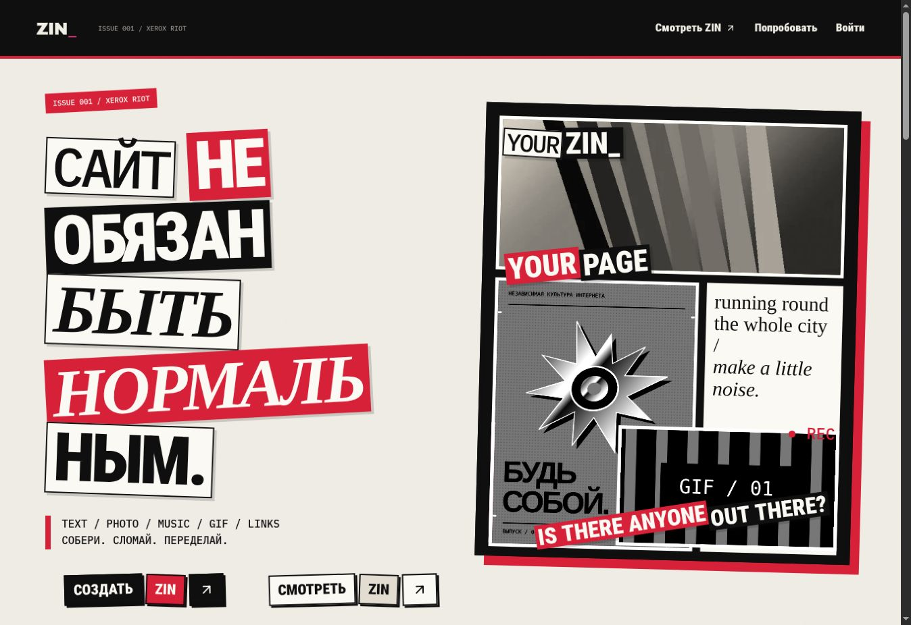
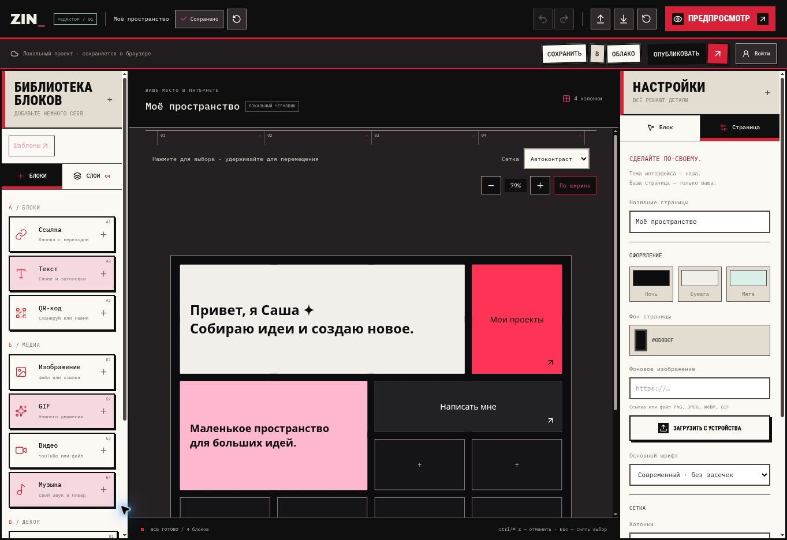

<div align="center">

# ZIN_

### ТВОЯ СТРАНИЦА. ТВОИ ПРАВИЛА.

Текст / Фото / Музыка / GIF / Ссылки

Визуальный редактор персональных страниц.  
Собирай композиции, смешивай медиа и создавай своё пространство в интернете.

**[Открыть ZIN](https://zinpages.ru/)** · **[Попробовать редактор](https://zinpages.ru/editor)** · **[Автор](https://github.com/smth2ng)**

React · TypeScript · Vite · Supabase

</div>



---

## Собери. Сломай. Переделай.

**ZIN** — инструмент для создания персональных страниц, творческих портфолио и подборок материалов.

Добавляй текст, изображения, музыку и ссылки. Перемещай элементы, меняй размеры, собирай слои и настраивай оформление. Начни с готового шаблона или пустого полотна.

Локальный редактор работает без регистрации. Облачный режим добавляет аккаунты, сохранение черновиков и публикацию страниц.

## Возможности

| Инструмент | Что можно сделать |
|---|---|
| **Свободное полотно** | Размещать элементы по сетке или свободно, менять размеры и поворот |
| **Слои и группы** | Объединять блоки, управлять наложением, скрывать и закреплять элементы |
| **Медиа** | Добавлять текст, ссылки, изображения, GIF, видео, музыку, QR-коды и декор |
| **Оформление** | Настраивать фон, цвета, рамки, прозрачность и собственные шрифты |
| **Анимации** | Добавлять движение, эффекты при наведении и визуальные фильтры |
| **Шаблоны** | Использовать готовые композиции и сохранять собственные |
| **Сохранение** | Использовать автосохранение, отмену действий, экспорт и импорт проекта |
| **Публикация** | Публиковать страницы и добровольно добавлять их в галерею Explore |

## Внутри редактора



1. Выбери шаблон или начни с пустого полотна.
2. Добавь текст, ссылки и медиа.
3. Настрой композицию и оформление.
4. Открой предпросмотр.
5. Экспортируй резервную копию или опубликуй страницу через аккаунт.

На компьютере блоки перемещаются мышью. На телефоне — после удержания. Быстрый свайп прокручивает полотно.

> Композиция сохраняет пропорции и масштабируется на узких экранах. Отдельная мобильная композиция автоматически не создаётся.

## Технологии

| Часть проекта | Решение |
|---|---|
| Интерфейс | React, TypeScript |
| Сборка | Vite |
| Маршрутизация | React Router |
| Состояние редактора | React Context + reducer |
| Управление мышью и касанием | Pointer Events |
| Локальное хранение | localStorage, IndexedDB |
| Облачный режим | Supabase Auth, PostgreSQL, Storage, Edge Functions |
| Тестирование | Vitest, Playwright |

Метаданные локального проекта сохраняются в localStorage, загруженные файлы — в IndexedDB. Полный JSON-экспорт включает используемые файлы.

Облачный черновик и опубликованная страница разделены: изменения в редакторе не должны автоматически становиться публичными.

## Локальный запуск

Понадобится **Node.js 24**, указанный в `.nvmrc`.

```bash
git clone https://github.com/Ibitiyus/link-canvas.git
cd link-canvas
npm ci
npm run dev
```

Открой `http://localhost:5173`. Редактор доступен по пути `/editor`.

Без переменных окружения Supabase приложение работает локально. Настройка аккаунтов, облачного хранения и публикации описана в [документации](docs/CLOUD.md).

## Сборка и проверки

```bash
npm run typecheck
npm test
npm run build
npm run test:e2e
```

Для браузерных тестов требуется Chromium:

```bash
npx playwright install chromium
```

Предпросмотр production-сборки:

```bash
npm run preview
```

Готовая сборка находится в `dist/`. Для прямых переходов на внутренние страницы на статическом хостинге потребуется SPA fallback на `index.html`.

## Ограничения

- Совместное редактирование в реальном времени пока не реализовано.
- История отмены сбрасывается после перезагрузки страницы.
- Очистка данных браузера удаляет локальный проект и его файлы — используй экспорт для резервной копии.
- Облачные функции требуют настроенного Supabase и применения миграций.
- Доступность сторонних медиа зависит от источника, сети и поддержки браузером.

## Документация

- [Облачный режим и публикация](docs/CLOUD.md)
- [Масштабирование полотна](docs/CANVAS-SCALING.md)
- [Свободное расположение и группы](docs/FREE-CANVAS.md)
- [Анимации и эффекты](docs/ANIMATIONS.md)
- [Шаблоны](docs/TEMPLATES.md)
- [Галерея Explore](docs/EXPLORE.md)
- [Проверки мобильного редактора](docs/MOBILE-EDITOR-VALIDATION.md)
- [Подготовка к публичному запуску](docs/PRODUCTION_READINESS.md)

## Автор

**[smth2ng](https://github.com/smth2ng)** — автор проекта ZIN.

Ранние коммиты связаны с моим учебным аккаунтом [Ibitiyus](https://github.com/Ibitiyus). Оба аккаунта принадлежат мне.

---

<div align="center">

**ZIN_ — СОБЕРИ СВОЁ МЕСТО В ИНТЕРНЕТЕ.**

[Открыть сайт](https://zinpages.ru/) · [GitHub автора](https://github.com/smth2ng)

</div>
